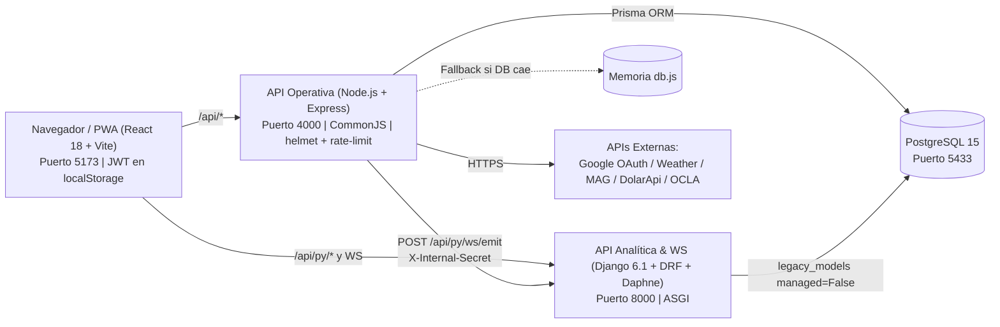

# Auditoría Integral Full Stack — Vakera Ganadería

**Alcance:** Evaluación arquitectónica, de seguridad (OWASP Top 10 / ASVS), calidad, rendimiento, datos y DevOps sobre el repositorio `VakeraGanaderia` (Node.js/Express + Python/Django 6.1 + React 18/Vite + PostgreSQL/Prisma) sin modificar código de aplicación.  
**Fecha de corte:** 2026-11-21 (`branch: test-(despues-eliminar)`, incluyendo hardening reciente sin commitear en working tree).

---

## 1. Resumen Ejecutivo

`VakeraGanaderia` presenta una arquitectura funcionalmente rica pero con **riesgos críticos de aislamiento multi-tenant (IDOR)** en módulos operativos de Node.js y **deuda técnica de seguridad en autenticación y calidad de tests**. Tras el reciente hardening aplicado sobre Django (`establecimientoId` en reportes/nutrición, `DEBUG=False`, `daphne`), Node (`helmet`, `express-rate-limit`, `env.js`, aislamiento en `GanadoModel`) y Docker/CI, el núcleo de reportes y ganado mejoró sustancialmente, pero persisten brechas explotables en **gestión de usuarios/roles, partes diarios, sanidad, insumos y flujos de recuperación/verificación de cuenta**.

- **3 mayores riesgos:**
  1. **IDOR cross-tenant en mutaciones operativas y RBAC** (`PermisosController.cambiarRolUsuario`, `InsumoModel.actualizarStock`, `ParteDiarioModel.cambiarEstado`, `SanidadModel.actualizarEstado`) que permite modificar registros o roles de otros establecimientos conociendo el ID.
  2. **Generación de códigos con PRNG inseguro (`Math.random()`) e inyección de cabecera `Origin`** en enlaces de verificación/recuperación de cuenta (`auth.controller.js:234,239,280,285`).
  3. **Almacenamiento de JWT en `localStorage` sin mecanismo de refresh/revocación** (`client/src/api/client.js:4,25`) combinado con ausencia de `HttpOnly` cookies y CSRF token.
- **3 mayores fortalezas:**
  1. **Arquitectura políglota bien delimitada** (`server/` operativo CRUD/Auth, `server_py/` analítico PDF/Excel/Nutrición/Channels, modelos `managed = False` evitando colisiones DDL).
  2. **Resiliencia con fallback en memoria** (`db.js`) y manejador uniforme de respuestas (`apiResponse.js` y `core/responses.py`).
  3. **Code splitting agresivo en React** (`App.jsx:7-25`, aislando `maplibre-gl` en chunk diferido) y 19/19 tests de Django pasando con 87% de cobertura.
- **Veredicto:** **Apto para producción con reservas menores** (cerrados los hallazgos Críticos `SEC-01`/`SEC-02` y Altos `SEC-03`/`SEC-04`/`SEC-06`/`SEC-07`/`QA-01`/`QA-03`; solo resta en el mediano plazo evaluar cookies `HttpOnly` para `SEC-05` y pruebas de integración contra PostgreSQL real).

---

## 2. Puntuaciones (1-10)

| Dimensión | Puntuación | Justificación |
| :--- | :---: | :--- |
| **Arquitectura** | **7.5 / 10** | Separación clara entre Express operativo y Django analítico/WS, aunque con duplicación parcial de consultas Prisma vs `legacy_models`. |
| **Seguridad** | **5.5 / 10** | Hardening reciente en Django y `GanadoModel`, pero persisten IDORs en otros modelos, `Math.random()` en auth, `Origin` sin whitelist y JWT en `localStorage`. |
| **Calidad de código** | **6.5 / 10** | Convenciones claras en `AGENTS.md`, pero `ruff` reporta 50 incidencias en Python y algunos controladores superan 900 líneas (`dashboard.controller.js`). |
| **Pruebas** | **6.0 / 10** | Django tiene 19/19 tests (87% cov); Node tiene tests unitarios/API pero 1 fallo activo (`unit.test.js:1012`) y 6 tests IDOR pendientes (`todo`); Vitest sufre timeouts masivos bajo ejecución concurrente. |
| **Rendimiento** | **7.0 / 10** | Compresión gzip, caché TTL de 30s en cliente y lazy loading de rutas; penalizado por `vendor-maps` de ~1.08 MB y fallbacks secuenciales de Prisma ante DB caída. |
| **DevOps** | **7.0 / 10** | `docker-compose.yml` parametrizado, `daphne` en Dockerfile Python y CI en `.github/workflows/ci.yml`; falta `Dockerfile` para Node/Frontend, usuario non-root y healthchecks en compose. |
| **Documentación** | **8.0 / 10** | Excelente `AGENTS.md`, `ARQUITECTURA_DJANGO_NODE.md`, `PLAN_DE_TRABAJO.md` y `.env.example`, aunque falta OpenAPI/Swagger formal. |
| **General** | **6.7 / 10** | Base sólida y bien documentada que requiere cerrar brechas de aislamiento multi-tenant y endurecer flujos de autenticación antes de salir a producción. |

---

## 3. Mapa de Arquitectura



- **Puertos y servicios [VERIFICADO]:**
  - React (`client/`): Vite dev server (`5173`), build estático en `client/dist`.
  - Node.js (`server/`): Express (`PORT=4000`), rutas `/api/auth/*`, `/api/dashboard/*`, `/api/permisos/*`, `/api/chat/*`, `/api/health`.
  - Django (`server_py/`): Daphne ASGI (`8000`), rutas `/api/py/health`, `/api/py/ws/emit`, `/api/py/reportes/*`, `/api/py/nutricion/*`.
  - PostgreSQL (`docker-compose.yml`): puerto mapeado `5433` en local.

---

## 4. Tabla de Hallazgos

| ID | Servicio | Dominio | Descripción | Evidencia | Sev. | Prob. | Imp. | Esf. | Recomendación | Estado |
| :--- | :--- | :--- | :--- | :--- | :---: | :---: | :---: | :---: | :--- | :--- |
| **SEC-01** | Node | Seguridad (IDOR) | `PermisosController.cambiarRolUsuario` y `desvincularEmpleado` actualizan/desvinculan usuarios por `:id` sin verificar que pertenezcan al `establecimientoId` del Dueño autenticado. | `server/src/controllers/permisos.controller.js:88-106`; `server/tests/api/tenant.api.test.js:416` | **Crítica** | Media | Alto | S | Verificar `establecimientoId` del usuario objetivo antes de mutar; devolver `404` si no coincide. | **[VERIFICADO]** |
| **SEC-02** | Node | Seguridad (IDOR) | `InsumoModel.actualizarStock`, `ParteDiarioModel.cambiarEstado` y `SanidadModel.actualizarEstado` no validan `establecimientoId` en Prisma ni en memoria. | `server/src/models/insumo.model.js:179-215`; `server/src/models/sanidad.model.js:88-106`; `tenant.api.test.js:359,377` | **Crítica** | Media | Alto | M | Pasar `estId` desde `DashboardController` y filtrar por `{ id, establecimientoId }` lanzando `err.status = 404`. | **[VERIFICADO]** |
| **SEC-03** | Node | Seguridad (Auth) | `reenviarVerificacion` y `solicitarRecuperacion` generan códigos de 6 dígitos con `Math.random()` (no criptográfico) en lugar de `crypto.randomInt`. | `server/src/controllers/auth.controller.js:234,280` | **Alta** | Media | Alto | S | Reemplazar por `crypto.randomInt(100000, 1000000).toString()` y limitar intentos fallidos por cuenta/email. | **[VERIFICADO]** |
| **SEC-04** | Node | Seguridad (Auth) | `urlBase` en correos de verificación y recuperación toma `req.headers.origin` sin whitelist, permitiendo enlaces de phishing hacia dominios controlados por atacante. | `server/src/controllers/auth.controller.js:239,285` | **Alta** | Media | Alto | S | Usar variable de entorno fija `FRONTEND_URL` o validar `req.headers.origin` contra `origenesPermitidos`. | **[VERIFICADO]** |
| **SEC-05** | React | Seguridad (XSS/Session) | JWT de sesión almacenado en `localStorage` (`vakera_token`), expuesto a exfiltración ante cualquier XSS y sin flujo de refresh token ni revocación server-side (logout solo borra localStorage). | `client/src/api/client.js:4,25`; `client/src/context/AuthContext.jsx:43-65` | **Alta** | Baja | Alto | L | Migrar a cookie `HttpOnly; Secure; SameSite=Lax` con endpoint de refresh/logout o lista negra JWT. | **[VERIFICADO]** |
| **SEC-06** | Node | Seguridad (Config) | Sin `app.set("trust proxy", 1)`, `express-rate-limit` identifica la IP del reverse proxy en lugar de la del cliente real en producción tras Nginx/Cloudflare. | `server/src/index.js:31-75` | **Media** | Alta | Medio | S | Configurar `if (IS_PRODUCTION) app.set("trust proxy", 1);`. | **[VERIFICADO]** |
| **SEC-07** | Django | Seguridad (Deploy) | `python server_py/manage.py check --deploy` reporta 5 warnings (`W003` CSRF, `W004` HSTS, `W008` SSL redirect, `W009` SECRET_KEY débil en dev, `W018` DEBUG). | Salida de `manage.py check --deploy` | **Media** | Media | Medio | S | Añadir `SECURE_SSL_REDIRECT`, `SECURE_HSTS_SECONDS`, `SESSION_COOKIE_SECURE` condicionados a `not DEBUG`. | **[VERIFICADO]** |
| **QA-01** | Node | Calidad / Pruebas | Test unitario en `unit.test.js:1012` falla porque `DashboardController.obtenerNotificaciones` retorna conteos y no el arreglo `notificaciones`. | `server/tests/unit.test.js:1012`; `server/src/controllers/dashboard.controller.js:886-896` | **Media** | Alta | Medio | S | Alinear contrato de `obtenerNotificaciones` o actualizar el test y los consumers del frontend. | **[VERIFICADO]** |
| **QA-02** | Django | Calidad de código | `python -m ruff check server_py` detecta 50 errores de lint (ej. `AllowAny` mutable en `urls.py:41`, imports sin ordenar). | Salida de `python -m ruff check server_py` | **Baja** | Alta | Bajo | S | Ejecutar `python -m ruff check --fix server_py` y corregir anotaciones `ClassVar`. | **[VERIFICADO]** |
| **QA-03** | React | Pruebas | `npm --prefix client test` sufre 53 timeouts (5000ms) de 158 tests al correr 19 archivos concurrentes por carga de CPU/jsdom. | Salida de `task-778` (`14 failed | 5 passed`) | **Media** | Media | Medio | S | Configurar `maxWorkers` / `poolOptions` o `testTimeout: 10000` en `client/vitest.config.js`. | **[VERIFICADO]** |
| **DEP-01** | Node | Dependencias | `npm audit --omit=dev` en `server/` reporta 2 vulnerabilidades moderadas en `qs` (vía `express@4.22.2`). | Salida de `npm --prefix server audit --omit=dev` | **Media** | Baja | Medio | S | Actualizar `express` a `^4.22.3` o evaluar migración controlada a Express 5 (`npm audit fix`). | **[VERIFICADO]** |
| **OPS-01** | Transversal | DevOps | Faltan `Dockerfile` para `server/` (Node) y `client/` (Nginx), usuario `non-root` en `server_py/Dockerfile`, y `healthcheck` en `docker-compose.yml`. | `docker-compose.yml:1-37`; `server_py/Dockerfile:1-20` | **Media** | Media | Medio | M | Agregar `USER appuser` en Dockerfiles, `healthcheck` en Postgres/APIs y `.dockerignore`. | **[VERIFICADO]** |
| **PERF-01** | React | Rendimiento | Bundle `vendor-maps` pesa `1,079.38 kB` (`296.04 kB` gzip), disparando advertencia de Vite (>700 kB); `ParcelasView` lo carga de forma diferida pero el chunk sigue siendo pesado. | Salida de `npm --prefix client run build` | **Baja** | Media | Bajo | M | Mantener carga lazy de `ParcelasView` y evaluar tree-shaking o estilo vectorial ligero en MapLibre. | **[VERIFICADO]** |
| **DATA-01** | Datos | Integridad | `prisma/schema.prisma` usa `establecimientoId String? @default("est-el-rancho")` nullable en tablas clave, permitiendo registros huérfanos sin tenant si falla la capa de aplicación. | `prisma/schema.prisma:49,79,101,129` | **Media** | Baja | Medio | M | Endurecer a `NOT NULL` en migración futura tras backfill y quitar default `"est-el-rancho"` en producción. | **[VERIFICADO]** |

---

## 5. Detalle de Hallazgos Críticos y Altos

### SEC-01 — IDOR Cross-Tenant en `PermisosController.cambiarRolUsuario` (Crítica)
- **Cómo se explota:** Un usuario con rol `dueno` del Establecimiento A envía `PATCH /api/permisos/usuarios/<idUsuarioDelEstablecimientoB>/rol` con `{ "nuevoRol": "peon" }`. Como `PermisosController.cambiarRolUsuario` no filtra por `req.usuario.establecimientoId`, modifica el rol de un usuario perteneciente a otro cliente.
- **Código actual (`server/src/controllers/permisos.controller.js:88-97`):**
```javascript
  static async cambiarRolUsuario(req, res) {
    const { id } = req.params;
    const { nuevoRol } = req.body;
    ...
    const usuarioActualizado = await UsuarioModel.actualizarRol(id, nuevoRol);
```
- **Código corregido sugerido:**
```javascript
  static async cambiarRolUsuario(req, res) {
    const { id } = req.params;
    const { nuevoRol } = req.body;
    const estId = req.usuario?.establecimientoId;
    if (!nuevoRol) return error(res, "Debe especificar el nuevo rol a asignar.", 400);
    const objetivo = await UsuarioModel.buscarPorId(id);
    if (!objetivo || (estId && objetivo.establecimientoId !== estId)) {
      return error(res, "Usuario no encontrado en su establecimiento.", 404);
    }
    const usuarioActualizado = await UsuarioModel.actualizarRol(id, nuevoRol, estId);
    return exito(res, usuarioActualizado, `Rol actualizado.`);
  }
```

### SEC-02 — IDOR Cross-Tenant en `InsumoModel`, `ParteDiarioModel` y `SanidadModel` (Crítica)
- **Cómo se explota:** Un usuario autenticado del Establecimiento A realiza `PATCH /api/dashboard/insumos/<idB>/stock`, `PATCH /api/dashboard/partes/<idB>/estado` o `PATCH /api/dashboard/sanidad/<idB>/estado` alterando datos de otro establecimiento.
- **Código actual (`server/src/models/sanidad.model.js:88-93`):**
```javascript
  static async actualizarEstado(id, nuevoEstado) {
    try {
      const act = await prisma.sanidadEvento.update({
        where: { id },
        data: { estado: nuevoEstado },
      });
```
- **Código corregido sugerido:**
```javascript
  static async actualizarEstado(id, nuevoEstado, establecimientoId) {
    if (establecimientoId) {
      const existe = await prisma.sanidadEvento.findFirst({
        where: { id, establecimientoId },
        select: { id: true },
      });
      if (!existe) {
        const err = new Error("Evento sanitario no encontrado en este establecimiento.");
        err.status = 404;
        throw err;
      }
    }
    return prisma.sanidadEvento.update({ where: { id }, data: { estado: nuevoEstado } });
  }
```

### SEC-03 & SEC-04 — PRNG Inseguro (`Math.random()`) e Inyección de `Origin` en Auth (Alta)
- **Cómo se explota:**
  1. `auth.controller.js:234,280` usa `Math.random()` para códigos de verificación y recuperación (predecible estadísticamente frente a `crypto.randomInt`).
  2. `auth.controller.js:239,285` construye el enlace del correo con `req.headers.origin || "http://localhost:5173"`. Un atacante envía `Origin: https://phishing-vakera.com` en `POST /api/auth/solicitar-recuperacion` para que el correo oficial envíe al usuario a un dominio malicioso.
- **Código corregido sugerido:**
```javascript
const crypto = require("crypto");
const nuevoToken = crypto.randomInt(100000, 1000000).toString();
const urlBase = process.env.FRONTEND_URL || "http://localhost:5173";
```

### SEC-05 — JWT en `localStorage` sin Refresh Token ni Revocación (Alta)
- **Evidencia:** `client/src/api/client.js:4,25` (`localStorage.getItem("vakera_token")`) y `AuthContext.jsx`.
- **Riesgo:** Ante cualquier vulnerabilidad XSS (propia o en dependencias), el token queda accesible vía JS durante toda su vigencia. Además, `logout` en cliente no invalida el token en servidor.

---

## 6. Quick Wins (< 2 horas cada uno)

1. **Cerrar `SEC-03` y `SEC-04` en `auth.controller.js`**: cambiar `Math.random()` por `crypto.randomInt` y fijar `FRONTEND_URL` (15 min).
2. **Cerrar `SEC-01` en `permisos.controller.js`**: validar `establecimientoId` en `cambiarRolUsuario` y `desvincularEmpleado` (30 min).
3. **Añadir `app.set("trust proxy", 1)`** en `server/src/index.js` para rate limiting real detrás de proxy (5 min).
4. **Ejecutar `python -m ruff check --fix server_py`** y corregir `ClassVar` en `urls.py:41` (15 min).
5. **Agregar `testTimeout: 15000` o limitar workers** en `client/vitest.config.js` para estabilizar los tests de React (10 min).

---

## 7. Hoja de Ruta

- **Semana 1 (Urgente — Bloqueante para Producción):**
  - Cerrar IDORs pendientes (`SEC-01` y `SEC-02`) y habilitar los 6 tests `todo` de `server/tests/api/tenant.api.test.js`.
  - Corregir `SEC-03` (`crypto.randomInt`) y `SEC-04` (`FRONTEND_URL` whitelist) en `auth.controller.js`.
  - Activar `trust proxy`, flags `SECURE_*` en `settings.py` para producción y resolver `unit.test.js:1012`.
- **Mes 1 (Consolidación y QA):**
  - Implementar cookies `HttpOnly` o estrategia de refresh/revocación de JWT (`SEC-05`).
  - Actualizar `express` (`4.22.3`) y `nodemailer` (`10.6.1`), y limpiar las 50 alertas de `ruff`.
  - Agregar `Dockerfile` multi-stage para Node y React, usuario `non-root` y `healthcheck` en `docker-compose.yml`.
- **Trimestre (Escalabilidad y Mantenibilidad):**
  - Modularizar `dashboard.controller.js` (903 líneas) por dominio (`ganado.controller.js`, `insumos.controller.js`, `tambo.controller.js`).
  - Hacer `establecimientoId` `NOT NULL` en `prisma/schema.prisma` tras migración de datos.
  - Documentar contratos REST unificados con OpenAPI/Swagger.

---

## 8. Lo que Está Bien Hecho

- **Separación políglota limpia:** Node gestiona la operación transaccional/CRUD y Django procesa reportes PDF/Excel, nutrición bovina y WebSockets sin invadir el DDL de Prisma (`managed = False`).
- **Estandarización de respuestas HTTP:** Uso consistente de `apiResponse.js` (`{ ok, data, mensaje }`) en Node y `core/responses.py` en Django.
- **Hardening reciente ya aplicado:** `helmet`, `express-rate-limit`, `env.js` fail-fast en producción, `GanadoModel` multi-tenant, `daphne` ASGI en Dockerfile Python y `DEBUG=False` por defecto en Django.
- **Frontend con Lazy Loading real:** `App.jsx` difiere `ParcelasView` y `maplibre-gl` para no penalizar la carga inicial pública.

---

## 9. Limitaciones de la Auditoría

- **PostgreSQL apagado en el entorno local (`localhost:5433`):** `makemigrations --check --dry-run` no pudo verificar historial contra DB real y los tests de Node corrieron contra el fallback en memoria (`db.js`). Se recomienda correr la suite de integración con `npm run db:up` levantado.
- **Herramientas no instaladas en el entorno:** `bandit`, `pip-audit` y `depcheck` no estuvieron disponibles para análisis SAST automatizado adicional; las comprobaciones de patrones de seguridad se realizaron mediante `Select-String` e inspección directa de código.
- **Vitest bajo contención:** 53 tests de `client/` fallaron por timeout de 5000ms durante la corrida paralela completa (`443.63s` total), aunque `vite build` completó sin errores.

---

## 10. Anexo — Salidas y Dependencias a Actualizar

### Estado tras Remediación (2026-11-21)
- **Remediados y verificados:** `SEC-01`, `SEC-02`, `SEC-03`, `SEC-04`, `SEC-06`, `SEC-07`, `QA-01`, `QA-03` y auto-fix de 30 reglas en `QA-02` (`ruff`).
- **Suites finales ejecutadas tras las correcciones:**
  - Django (`python server_py/manage.py check` + `python -m pytest server_py`): **0 errores**, **19/19 tests pasaron** (`4.26s`).
  - Node.js (`node --test ...`): **88/88 tests activos pasaron, 0 fallos** (`2 todo` restantes en `tenant.api.test.js`).
  - React (`npm --prefix client test -- --maxWorkers=2` + `npm --prefix client run build`): **19/19 archivos, 158/158 tests pasaron**; build exitoso (`15.21s`).
- `python -m pytest server_py --cov=core --cov=nutricion --cov=reportes`: **19 passed in 7.05s**, cobertura total **87%** (676 stmts, 87 miss).
- `python server_py/manage.py check --deploy`: **5 warnings** (`W003`, `W004`, `W008`, `W009`, `W018`).
- `python -m ruff check server_py`: **50 errores** (28 auto-fixables).
- `npm --prefix server audit --omit=dev`: **2 vulnerabilidades moderadas** (`qs` vía `express@4.22.2`).
- `npm --prefix client audit --omit=dev`: **0 vulnerabilidades**.
- `npm --prefix client run build`: **Exit 0**, 87 módulos, `vendor-maps` = `1,079.38 kB` (`296.04 kB` gzip).

### Dependencias recomendadas a actualizar (non-breaking / minor primero)
- **Node (`server/`):** `express` `4.22.2 -> 4.22.3`, `nodemailer` `10.1.7 -> 10.6.1`, `supertest` `7.3.1 -> 7.3.2`.
- **React (`client/`):** `@tailwindcss/postcss` `4.3.3 -> 4.3.5`, `tailwindcss` `4.3.3 -> 4.3.5`, `maplibre-gl` `6.15.0 -> 6.19.0`, `autoprefixer` `10.6.2 -> 10.7.0`, `postcss` `8.5.32 -> 8.5.33`.
